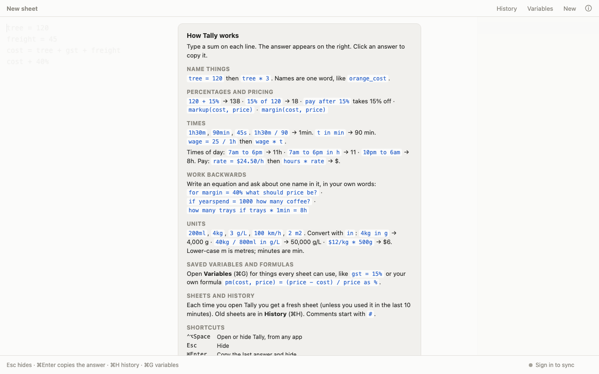

# Tally (web build)

Tally is a notepad calculator: you write sums on lines, name values, and keep a history. This repo holds only the built web app, an installable PWA for my own use.



## Use

Open `index.html` through any static file server, for example:

```bash
python3 -m http.server
```

There is no source code or build step here. The source lives elsewhere.

## Deploy

The repo is static files plus a `.nojekyll` file, and the last commit is a "Deploy" commit, so it looks like it is served by GitHub Pages. I have not confirmed the host.
